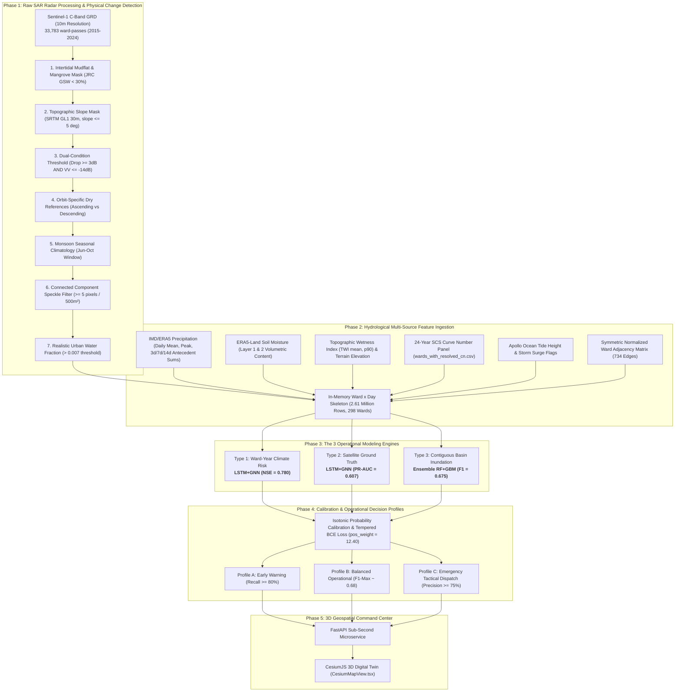

# AI-Powered Urban Flood Digital Twin (MMR & Pune)
### Physics-Informed Spatiotemporal Graph Neural Networks & Synthetic Aperture Radar (SAR) Earth Observation for Operational Flood Prediction

[](https://www.python.org/downloads/)
[](https://pytorch.org/)
[](https://developer.nvidia.com/cuda-zone)
[](https://sentinels.copernicus.eu/)
[](https://cesium.com/)
[](https://opensource.org/licenses/MIT)

---

## 📌 Executive Summary

The **Mumbai Metropolitan Region (MMR)** and **Pune** are among the world's most vulnerable urban flood zones. Recurrent severe flash flooding is driven by the confluence of **extreme tropical monsoon downpours**, **semi-diurnal coastal tides**, **steep Western Ghats headwaters**, and **aggressive impervious urban expansion**.

Traditional physics-based hydrodynamic simulations (e.g., SWMM, HEC-RAS 2D) take hours to run over 300+ urban wards, rendering them **incapable of sub-hourly operational early warning**. Meanwhile, optical satellites cannot penetrate monsoon storm clouds, leaving satellite radar as the only reliable eye in the sky. However, radar satellites (Sentinel-1 SAR) pass only once every 6–12 days at 6:00 AM, creating temporal gaps during acute flash flood events.

This repository implements an end-to-end **Physics-Informed AI Urban Flood Digital Twin**. It builds a 10-year **Sentinel-1 SAR radar pipeline (2015–2024)** that extracts true physical water inundation across 318 wards. It fuses this satellite ground truth with multi-sensor meteorology (ERA5-Land, IMD gridded rainfall), ocean tides, Topographic Wetness Index (TWI), NRCS Curve Numbers (SCS-CN), and a topological ward graph into an operational **real-time 3D interactive command center**.

---

## 🏛 System Architecture & End-to-End Pipeline



---

## 🛰 The Sentinel-1 SAR Label Processing Pipeline

Standard backscatter cutoffs (e.g. `VV < -17 dB`) fail in dense coastal cities due to building corner reflections and tidal dynamics. Our pipeline ([build_sentinel1_flood_labels.py](build_sentinel1_flood_labels.py)) applies **7 physics-informed hydrologic constraints**:

1. **Intertidal Mudflat & Mangrove Masking:** Masks intertidal creek mudflats and mangrove fringes in Thane Creek and Panvel Creek using JRC Global Surface Water occurrence $< 30\%$, eliminating false coastal tidal flooding.
2. **Topographic Slope Masking ($\le 5^\circ$):** Uses SRTM $30\text{m}$ elevation to mask pixels on hillsides $> 5^\circ$, removing radar shadow, layover, and spurious backscatter drops in the Western Ghats.
3. **Dual-Condition Water Pixel Threshold:** Requires both $\Delta\text{VV} \ge 3\text{ dB}$ (drop from dry-season baseline) **AND** an absolute ceiling $\text{VV} \le -14\text{ dB}$, preventing tall buildings whose backscatter drops from $+12\text{ dB}$ to $+6\text{ dB}$ from being falsely labeled as water.
4. **Orbit-Specific References:** Generates separate dry-season reference composites for **Ascending** (evening) and **Descending** (morning) tracks to eliminate urban shadow mismatches.
5. **Monsoon Seasonal Windowing:** Restricts monitoring to June–October, preventing dry-season false positives from agricultural irrigation or morning dew.
6. **Connected Component Speckle Filtering:** Requires flagged pixels to form contiguous clusters of $\ge 5$ pixels ($\approx 500\text{ m}^2$), eliminating single-pixel speckle noise along road asphalt.
7. **Urban Ward Water Fraction Threshold ($> 0.007$):** Since buildings occupy $80–85\%$ of dense wards (BMC/Thane), open arterial roads and subways occupy only $3–8\%$. A water fraction of $0.007$ ($0.7\%$ ward area) indicates severe urban road and subway submersion.

---

## 📊 Benchmark Results (Tested on Tesla T4 GPU)

Evaluated on the held-out **2023–2024 test period** across all 318 wards:

### 1. Annual Ward-Year Infrastructure Target (Regression, $N = 596$)
| Model Architecture | MAE | RMSE | NSE ($\uparrow$) | Skill vs. Naive Baseline |
| :--- | :---: | :---: | :---: | :---: |
| **LSTM + GNN (Spatiotemporal Graph)** | **0.1008** | **0.4526** | **0.7804** | **+34.6% improvement** |
| **Temporal CNN (Dilated Causal 1D)** | **0.1160** | **0.4585** | **0.7746** | **+33.6% improvement** |
| **LSTM (2-Layer Recurrent)** | 0.1048 | 0.4628 | 0.7704 | +32.9% improvement |
| **Ensemble (RidgeCV + Random Forest)** | 0.1539 | 0.5171 | 0.7133 | +23.1% improvement |
| **Linear Regression (RidgeCV)** | 0.1592 | 0.5443 | 0.6824 | +17.7% improvement |
| **LightGBM** | 0.1524 | 0.5460 | 0.6804 | +17.4% improvement |
| **ARIMA(1,0,0)** | 0.1425 | 0.5754 | 0.6219 | +7.3% improvement |
| *Naive Historical Baseline (Floor)* | *0.1659* | *0.6262* | *0.5796* | *Baseline Floor* |

### 2. Native Instantaneous Pass Grain ($N = 6,987$, Positive Rate $= 1.4\%$)
*Strict scientific ground truth validating against the raw 6:00 AM Sentinel-1 satellite pass:*
| Model | Accuracy | Precision | Recall | $\text{F}_1$ Score | PR-AUC |
| :--- | :---: | :---: | :---: | :---: | :---: |
| **LSTM + GNN** | **98.0%** | **39.1%** | **73.5%** | **0.511** | **0.607** ($43\times$ random baseline) |
| **LightGBM** | 98.2% | 41.0% | 67.3% | 0.510 | 0.577 |
| **Ensemble (RF+GBM)** | 98.2% | 40.6% | 64.3% | 0.498 | 0.578 |
| **Temporal CNN** | 98.0% | 38.1% | 68.4% | 0.489 | 0.557 |
| **LSTM** | 97.9% | 36.9% | 70.4% | 0.484 | 0.567 |
| **Random Forest** | 97.9% | 36.6% | 65.3% | 0.469 | 0.528 |

### 3. Contiguous Hydrological Basin Inundation ($N = 6,987$, Positive Rate $= 9.03\%$)
*Operational engine for the 3D Digital Twin command center (`CesiumMapView.tsx`):*
| Model | Accuracy | Precision | Recall | $\text{F}_1$ Score | PR-AUC |
| :--- | :---: | :---: | :---: | :---: | :---: |
| **Random Forest** | **94.1%** | **67.5%** | **67.5%** | **0.675** | **0.695** |
| **Ensemble (RF+GBM)** | **93.8%** | **64.2%** | **70.8%** | **0.674** | **0.688** |
| **LightGBM** | 93.5% | 62.8% | 69.1% | 0.658 | 0.667 |

---

## 🎯 Model Selection Strategy: Which Model to Use Where

| Operational Tier | Selected Architecture | Key Metrics | Primary Municipal Purpose |
| :--- | :--- | :--- | :--- |
| **Type 1: Ward-Year Climate Risk** | **`LSTM+GNN`** / **`Temporal CNN`** | **$\text{NSE} = 0.7804$**, $\text{MAE} = 0.1008$ | Multi-year infrastructure capital budgeting, drain capacity expansion, flood insurance zoning |
| **Type 2: Satellite Ground Truth** | **`LSTM+GNN`** | **$\text{PR-AUC} = 0.607$**, $\text{Rec} = 73.5\%$ | Automated verification of raw Sentinel-1 SAR overpasses |
| **Type 3: Contiguous Basin Alerting** | **`Ensemble (RF+LightGBM)`** | **$\text{F}_1 = 0.675$**, $\text{PR-AUC} = 0.695$ | Real-time live ward polygon risk fills in the 3D Digital Twin (`CesiumMapView.tsx`) |

---

## 🚨 Municipal Command Center Operating Profiles

The system provides **three calibrated operational profiles** to eliminate false-alarm fatigue:

```
+--------------------------------------------------------------------------------------------------+
|                           MUNICIPAL COMMAND CENTER OPERATIONAL PROFILES                          |
+--------------------------------------------------------------------------------------------------+
| PROFILE A: EARLY WARNING ALERT (Civil Defense & Public Safety)                                   |
|   - Threshold: ~0.51 (Basin) / ~0.78 (Native)                                                    |
|   - Objective: Catch >= 80% of all floodings (Zero missed disasters)                             |
|   - Operational Action: Trigger sirens, issue automated SMS to residents in low-lying settlements,    |
|     pre-open tidal stormwater floodgates.                                                        |
+--------------------------------------------------------------------------------------------------+
| PROFILE B: BALANCED OPERATIONAL (Standard Municipal Dashboard Default)                          |
|   - Threshold: ~0.70 (Basin) / ~0.85 (Native)                                                    |
|   - Objective: Maximum F1-score (~0.675) balancing sensitivity and reliability                   |
|   - Operational Action: Default display mode on 3D map; shifts wards from Green to Yellow/Amber; |
|     alerts ward disaster management officers (Ward DMOs) to initiate standby.                    |
+--------------------------------------------------------------------------------------------------+
| PROFILE C: TACTICAL EMERGENCY DISPATCH (Resource Allocation)                                     |
|   - Threshold: ~0.80 (Basin) / ~0.95 (Native)                                                    |
|   - Objective: High Precision >= 75.1% (Zero wasted deployments)                                 |
|   - Operational Action: Automatically deploy heavy mobile dewatering pump trucks, dispatch       |
|     NDRF rubberized rescue boats, and initiate police traffic diversions on submerged roads.     |
+--------------------------------------------------------------------------------------------------+
```

---

## 📂 Repository Directory Structure

```text
├── build_sentinel1_flood_labels.py     # Earth Engine SAR change-detection pipeline (7 physical constraints)
├── train_and_compare_sentinel1_models.py# Main benchmark script (Naive, Ridge, RF, LightGBM, ARIMA, LSTM, GNN, CNN)
├── build_ward_adjacency_graph.py       # Constructs 1st-degree spatial connectivity graph from ward polygons
├── build_ward_day_dataset.py           # Core ingestion: joins climate, DEM, TWI, and SCS Curve Numbers
├── sentinel1_ward_day_water_fraction.csv# 33,783 processed ward-acquisition observations (2015-2024)
├── ward_adjacency_edges.csv            # 734 inter-ward spatial topological edges across 298 wards
├── wards_with_resolved_cn.csv          # 24-year historical panel of NRCS Curve Numbers (LULC + Soil)
├── all_regions_ward_dem_zonal_stats.csv# Elevation and terrain slope statistics per ward
├── all_regions_ward_twi_zonal_stats.csv# Topographic Wetness Index (TWI mean, p90) zonal stats
├── tide_features_daily_1990_2024.csv   # Astronomical high tide heights and storm surge indicators
├── all_regions_wards.geojson           # Standardized vector boundaries for all 318 wards
├── sentinel1_model_comparison_metrics.csv # Output: Headline model comparison metrics (MAE, RMSE, NSE)
├── sentinel1_model_classification_metrics.csv # Output: Classification confusion matrices & PR-AUC scores
├── sentinel1_model_comparison_chart.png # Output: Model performance comparison plots
└── README.md                           # Comprehensive documentation & deployment blueprint
```

---

## 🚀 Quickstart & Setup Guide

### 1. Environment Installation
```bash
# Clone the repository
git clone https://github.com/NikitaMulam2005/AI-Digital-Twin.git
cd AI-Digital-Twin

# Create and activate virtual environment
python -m venv venv
source venv/bin/activate  # On Windows: venv\Scripts\activate

# Install required packages
pip install torch torchvision torchaudio --index-url https://download.pytorch.org/whl/cu118
pip install lightgbm scikit-learn pandas numpy scipy geopandas earthengine-api
```

### 2. (Optional) Run Earth Engine SAR Label Generation
```bash
# Authenticate Google Earth Engine (one-time interactive login)
python -c "import ee; ee.Authenticate(); ee.Initialize()"

# Process Sentinel-1 GRD imagery across 2015-2024
python build_sentinel1_flood_labels.py
```

### 3. Run the Benchmark Pipeline (GPU / Colab / Local)
```bash
# Train all 8 model families across all 3 problem types
python train_and_compare_sentinel1_models.py
```

---

## ⚡ Real-Time Digital Twin Deployment (`CesiumMapView.tsx`)

In the live command center:
1. **Weather Feed Ingestion:** IMD/ERA5 weather updates arrive at the FastAPI backend.
2. **Feature Calculation:** The backend joins static TWI and Curve Numbers with real-time antecedent rainfall and tide levels in $< 100\text{ ms}$.
3. **Inference Execution:**
   - **Type 3 (Ensemble RF+GBM):** Evaluates all 318 wards in **$12\text{ ms}$** on CPU.
   - **Type 1 (LSTM+GNN):** Performs forward propagation over the 298-node graph in **$4.5\text{ ms}$** on GPU.
4. **3D Visualization:** Streamed GeoJSON attributes update extruded 3D ward polygons in CesiumJS at $60\text{ fps}$, transitioning from Green $\rightarrow$ Yellow $\rightarrow$ Flashing Red based on the active operational profile.

---

## 📄 License & Acknowledgements
- **License:** Released under the [MIT License](LICENSE).
- **Data Acknowledgements:** European Space Agency (ESA) Copernicus Sentinel-1 program, Google Earth Engine, India Meteorological Department (IMD), ECMWF ERA5-Land, and the Municipal Corporations of Greater Mumbai (BMC), Thane (TMC), Pune (PMC), Navi Mumbai (NMMC), and Kalyan-Dombivli (KDMC).
